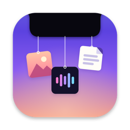
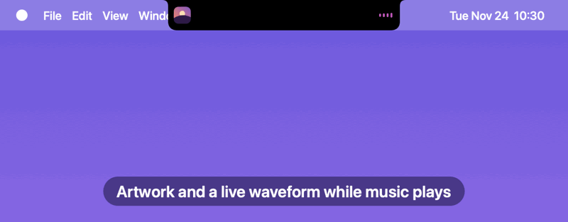

<p align="center">
  
</p>

<h1 align="center">Eave</h1>

<p align="center">
  Turn your MacBook notch into an eave — music, screenshots and files, hanging right at the top of your screen.
</p>

<p align="center">
  <b>English</b> · <a href="README.zh-CN.md">简体中文</a>
</p>

<p align="center">
  <a href="https://github.com/joeqiao64/eave/releases/latest"><b>⬇︎ Download the latest release</b></a>
</p>

<p align="center">
  
</p>

## Features

**🎵 Music**
- While music plays, the notch grows small wings with the album art and a live waveform (tinted from the artwork)
- Hover the notch and it smoothly opens into a mini player: previous / play-pause / next
- Click or drag the progress bar to seek
- Works with Apple Music and Spotify

**🗂 Shelf**
- Drag files or images onto the notch — it opens into a drop zone, let go to park them
- Dragging items out **always copies**; the original stays where it is
- Real thumbnails for images and screenshots; **press firmly** (Force Touch) or long-press to peek, release to close
- Click to select, Space for Quick Look, double-click to open, ⌘-click to multi-select, right-click for more
- One-click AirDrop and clear; the shelf survives restarts

**📸 Screenshots**
- `⇧⌘A` to capture a region (Space switches to window capture, Esc cancels)
- Screenshots land on the shelf and are copied to the clipboard
- Take several in a row — nothing gets lost, newest first

**⚙️ Settings**
- Custom screenshot shortcut, display toggles, launch at login
- Language: follow system / 简体中文 / English
- **Check for updates** — Eave checks GitHub daily; when a new version is out, click **Update Now** and it downloads, verifies its signature, installs and relaunches by itself

## Install

### Homebrew (recommended)

```bash
brew tap joeqiao64/tap
brew trust --cask joeqiao64/tap/eave   # Homebrew asks you to trust third-party casks once
brew install --cask joeqiao64/tap/eave
```

Eave updates itself from **Settings → Updates** (or `brew upgrade --cask eave`).

### Manual download

1. Download `Eave.zip` from [Releases](https://github.com/joeqiao64/eave/releases/latest), unzip it and drag **Eave.app** into Applications.
2. **First launch** (Homebrew installs too): Eave isn't notarized by Apple, so macOS will say it can't verify the developer.
   - Open **System Settings → Privacy & Security**, scroll down to Eave and click **"Open Anyway"**, then confirm.
   - You only need to do this once.
3. **Permissions** (macOS asks when they're first needed):
   - **Screen Recording** — for screenshots. After granting it, quit and reopen Eave.
   - **Automation (Music / Spotify)** — to show and control the current song.

> 💡 Eave lives in the menu bar and has no Dock icon. Click the notch icon in the menu bar to take a screenshot, open Settings, or quit.

## Usage

| Action | How |
|---|---|
| Open / close | Move the pointer onto / away from the notch |
| Screenshot | `⇧⌘A` (changeable in Settings) |
| Add to shelf | Drag a file or image onto the notch |
| Take a file out | Drag it from the shelf anywhere (copies) |
| Peek | Press a thumbnail firmly, or hold for ~0.35 s |
| Quick Look | Select, then press Space |
| Open | Double-click a thumbnail |
| Switch music / shelf | Shelf icon at the top right of the player; ‹ at the top left of the shelf |
| Settings | Menu bar icon → Settings… (`⌘,`) |

## Requirements

- macOS 14 Sonoma or later, Apple silicon
- Best on a MacBook with a notch; on other displays Eave shows a small pill at the top centre

## Build from source

Requires Xcode or the Xcode Command Line Tools (`xcode-select --install`).

```bash
git clone https://github.com/joeqiao64/eave.git
cd eave
./build.sh          # builds and installs ~/Applications/Eave.app
open ~/Applications/Eave.app
```

> Local builds are ad-hoc signed, so macOS may ask for Screen Recording again after each rebuild. If your keychain has a code-signing certificate named `Perch Local Signing`, `build.sh` signs with it and permissions survive rebuilds.

## Known limitations

- Music currently supports Apple Music and Spotify only (through their official AppleScript interfaces); web players and other apps aren't supported yet.
- Not notarized by Apple — the first launch needs a manual "Open Anyway" (see Install).

## License

[MIT](LICENSE)
