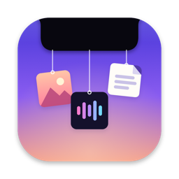

<p align="center">
  
</p>

<h1 align="center">Eave</h1>

<p align="center">
  把 MacBook 的刘海变成屋檐：音乐、截图、文件，都挂在屏幕顶上，伸手就到。<br>
  <sub>Turn your MacBook notch into an eave — music, screenshots and files, right at the top of your screen.</sub>
</p>

<p align="center">
  <a href="README.md">English</a> · <b>简体中文</b>
</p>

<p align="center">
  <a href="https://github.com/joeqiao64/eave/releases/latest"><b>⬇︎ 下载最新版</b></a>
</p>

<p align="center">
  
</p>

## 功能

**🎵 音乐**
- 播放音乐时，刘海两侧显示专辑封面和跳动的音波（颜色取自封面）
- 鼠标移到刘海上，平滑展开成迷你播放器：上一首 / 播放暂停 / 下一首
- 进度条可以点击或拖动跳转
- 支持 Apple Music 和 Spotify

**🗂 文件架**
- 把文件、图片拖到刘海，自动展开成放入区，松手即暂存
- 从文件架拖出去 **永远是复制**，原文件不动
- 图片、截图显示真实缩略图；**用力按**（Force Touch）或长按预览大图，松手收起
- 单击选中，空格 Quick Look，双击打开，⌘ 多选，右键更多操作
- 一键 AirDrop、一键清空，重启后内容还在

**📸 截图**
- `⇧⌘A` 框选截图（按空格切换为窗口截图，Esc 取消）
- 截图自动放进文件架，并复制到剪贴板
- 连续截多张也不会丢，最新的排在最前面

**⚙️ 设置**
- 自定义截图快捷键、各项显示开关、开机自动启动
- 界面语言：跟随系统 / 简体中文 / English

## 安装

### 用 Homebrew（推荐）

```bash
brew install --cask joeqiao64/tap/eave
```

以后更新：`brew upgrade --cask eave`

### 手动下载

1. 到 [Releases](https://github.com/joeqiao64/eave/releases/latest) 下载 `Eave.zip`，解压后把 **Eave.app** 拖进「应用程序」文件夹。
2. **第一次打开**（Homebrew 安装的也一样）：因为 Eave 没有经过苹果公证，macOS 会提示「无法验证开发者」。
   - 打开 **系统设置 → 隐私与安全性**，在页面下方找到 Eave，点 **「仍要打开」**，再确认一次即可。
   - 这只需要做一次。
3. **授权**（用到时系统会自动询问）：
   - **屏幕录制**：截图功能需要。打开后请退出并重新打开 Eave。
   - **自动化（Music / Spotify）**：显示和控制正在播放的歌曲需要。

> 💡 Eave 是一个菜单栏应用，没有程序坞图标。点菜单栏里的刘海图标可以截图、打开设置或退出。

## 使用

| 操作 | 方式 |
|---|---|
| 展开 / 收起 | 鼠标移到刘海上 / 移开 |
| 截图 | `⇧⌘A`（可在设置里修改） |
| 放入文件架 | 把文件或图片拖到刘海 |
| 取出文件 | 从文件架拖到任意位置（复制） |
| 预览 | 用力按缩略图，或长按约 0.35 秒 |
| Quick Look | 单击选中后按空格 |
| 打开 | 双击缩略图 |
| 切换音乐 / 文件架 | 音乐页右上角的文件架图标；文件架页左上角的 ‹ |
| 设置 | 菜单栏图标 → 设置…（`⌘,`） |

## 系统要求

- macOS 14 Sonoma 或更新版本，Apple 芯片
- 带刘海的 MacBook 体验最佳；没有刘海的屏幕会在顶部中央显示一个胶囊形状

## 从源码构建

需要 Xcode 或 Xcode 命令行工具（`xcode-select --install`）。

```bash
git clone https://github.com/joeqiao64/eave.git
cd eave
./build.sh          # 编译并安装到 ~/Applications/Eave.app
open ~/Applications/Eave.app
```

> 自己编译的版本默认使用临时签名（ad-hoc），每次重新编译后 macOS 可能要求重新授权屏幕录制。如果你在钥匙串里有一个名为 `Perch Local Signing` 的代码签名证书，`build.sh` 会自动用它签名，权限就不会因为重新编译而失效。

## 已知限制

- 音乐目前只支持 Apple Music 和 Spotify（通过它们的官方 AppleScript 接口），网页播放器和其他音乐 App 暂不支持。
- 没有经过苹果公证，第一次打开需要手动允许（见上方安装步骤）。

## 许可

[MIT](LICENSE)
